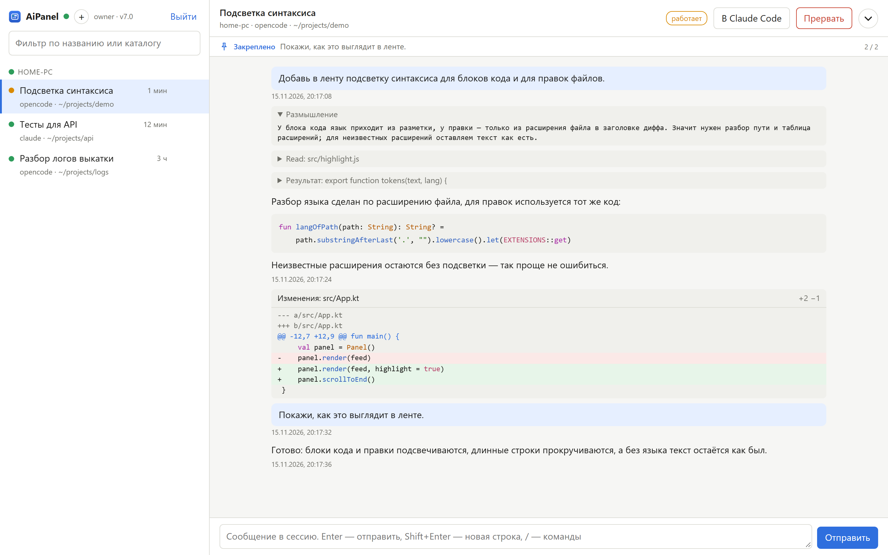
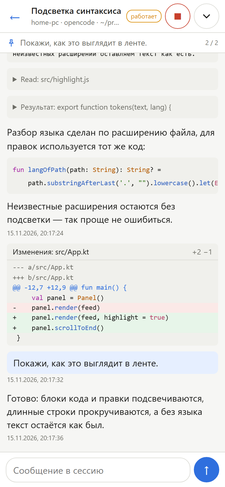

# AiPanel

Веб-панель для локальных сессий Claude Code и opencode: в браузере видно состояние каждой сессии и её ленту, из браузера можно отправить в сессию новое сообщение, ответить на запрос opencode (разрешение или вопрос с вариантами), прервать работу или запустить новую сессию Claude Code или opencode в выбранном каталоге.



<p align="center">
  
</p>

Сессии, каталоги и переписка на скриншотах выдуманы: их рисует `node tests/ui/screens.mjs` из той же страницы, что и тесты интерфейса, — в кадр не попадают ни настоящие проекты, ни настоящие сообщения.

## Как это устроено

```
браузер ──HTTPS/WSS──> aipanel-server (Docker, хостинг) <──WSS── aipanel-agent (ваша машина)
                                                                    ├─ Claude Code: ~/.claude
                                                                    └─ opencode: локальный HTTP API
```

- **`crates/server`** — сервер панели на Rust (axum). Отдаёт интерфейс (статика встроена в бинарник) и пересылает сообщения между браузером и агентами. Ленты сессий не хранит, в памяти только списки сессий.
- **`crates/agent`** — локальный агент. Сам подключается к серверу исходящим WebSocket, поэтому входящие порты на домашней машине не нужны.
- **`crates/proto`** — общие типы протокола.

Фронтенд написан на обычном JavaScript без сборки: на память хостинга язык фронтенда не влияет, а сборка WASM усложнила бы образ.

Замеры на тестовом запуске: контейнер сервера занимает около 0,7 МБ памяти, образ — 1,7 МБ; агент — около 6 МБ памяти, exe — 1,1 МБ.

## Что агент умеет

| Сессия | Состояние и лента | Отправка сообщения | Прерывание |
|---|---|---|---|
| Claude Code, открыта в терминале | реестр `~/.claude/sessions`, транскрипт `.jsonl` | текст набирается в консоль сессии и отправляется Enter (только Windows) | Esc в консоль |
| Claude Code, закрыта | транскрипт `.jsonl` | на компьютере открывается окно Windows Terminal с `claude --resume <id> -- <текст>`, сообщение уходит первым запросом | — |
| opencode, не активна | API фонового сервиса | `POST /api/session/{id}/prompt`; при `windows = true` — окно Windows Terminal с `opencode -s <id> --prompt=<текст>` | — |
| opencode, работает или открыта в окне | API фонового сервиса | `POST /api/session/{id}/prompt` | `POST /api/session/{id}/interrupt` |

В панели Enter отправляет сообщение, Shift+Enter переносит строку. На телефоне Enter переносит строку, а отправляет кнопка.

Кнопка у поля ввода одна, как в Telegram: на пустом поле она показывает микрофон, на набранном тексте — отправку, а во время записи — красную остановку. Нажатие на микрофон начинает запись, повторное — заканчивает и отправляет её на распознавание (дольше двух минут не пишет). Запись уходит агенту той машины, к которой относится открытая сессия, и распознаётся на ней: сервер только передаёт её, звук не покидает ваш компьютер и никуда не отправляется.

Распознаёт GigaAM v3 — русская модель на процессоре, которая отдаёт текст с пунктуацией и заглавными: 10 секунд речи — около секунды счёта. Модель (~300 МБ) скачивается один раз при первой записи в каталог агента (`~/.aipanel/models`, у копии с `--home` — свой) и дальше работает без сети. Пока идёт распознавание, подсказка под полем показывает, чего ждёт панель; текст вставляется на место каретки, и его можно править перед отправкой.

Латиницу модель слышит по-русски (`cargo` → «карго»), поэтому в `[voice]` `agent.toml` есть два списка: `terms` — слова, к которым смещается декодер, и `[voice.fix]` — замены в готовом тексте, без учёта регистра. Голосовой ввод работает и на телефоне: микрофон у телефона, счёт — на компьютере с агентом.

Панель проверяет запись до отправки: телефон иногда отдаёт микрофон, который замолкает через полсекунды (его заняло другое приложение, подключены наушники без микрофона, микрофон выключен в шторке). В файл тогда пишется тишина, а модель на обрезке фразы выдаёт правдоподобные, но выдуманные слова. Если в записи почти нет звука, панель её не отправляет и говорит, что микрофон молчит; агент проверяет то же самое ещё раз — по длительности и громкости записи.

В поле ввода `/` в начале сообщения открывает список команд сессии, как в терминале. У opencode это его команды (`/init`, `/review` и команды из его настроек), у Claude Code — встроенные команды, файлы `commands/*.md` и навыки `skills/*` из `~/.claude` и каталога проекта. В списке видны описания из файлов команд, он фильтруется по имени, стрелки выбирают пункт, Enter подставляет команду, Esc закрывает список. Отправленная команда выполняется: opencode — отдельным запросом к своему API, Claude Code — набором в консоль открытой сессии (закрытая получила бы `/clear` как обычный текст, поэтому у неё списка нет).

У сессий opencode в этом списке есть ещё пункт `models`: он открывает выбор модели сессии (фильтр по названию или провайдеру, текущая отмечена). Выбор переключает сессию и записывается как последняя модель окна opencode — иначе при `model = "auto"` следующее сообщение из панели вернуло бы прежнюю.

Над лентой закреплено последнее своё сообщение: нажатие переводит к нему, а закреп переключается на предыдущее, как в Telegram. Если нажатие пришлось на самое старое сообщение, а ранние ещё не загружены, панель догружает их до предыдущего своего и везёт к нему; когда раньше своих больше нет, закреп снова уходит к последнему. При обычной прокрутке закреп следует за лентой и показывает своё сообщение, ближайшее выше верхней кромки, а у самого низа — последнее своё. Когда лента прокручена вверх, справа внизу появляется кнопка возврата в конец переписки. Место чтения ленты каждой сессии и прокрутка списка сессий хранятся у агента в `scroll.json`: сессия открывается там, где её читали, в том числе по ссылке, после перезапуска панели и с другого устройства. Привязано оно к сообщению у верхней кромки, поэтому новый ответ или догруженные ранние сообщения не сдвигают место; у самого конца сохраняется признак «в конце», и лента продолжает следовать за новым текстом.

Агент присылает только последние сообщения сессии (у opencode — 100, у Claude Code — 4 МБ транскрипта, но не больше 200 элементов), поэтому в начале ленты есть кнопка «Загрузить ранние сообщения»: она догружает предыдущую порцию и ставит её над показанным, не сдвигая место, которое вы читаете. Пока страница есть, кнопка остаётся; когда ранних сообщений не осталось — прячется. Если в сессии ничего не обрезано, кнопки нет вовсе. У opencode порции идут по курсору его API, у Claude Code — по смещению в транскрипте, так что сообщения не повторяются и не теряются.

Вызовы инструментов, которые меняют файлы, показываются в ленте раскрытым диффом: удалённые строки подсвечены красным, добавленные — зелёным. У Claude Code источник — `structuredPatch` из `toolUseResult` транскрипта, у opencode — патчи из `metadata.files`; для `Write`/`write` дифф строится по содержимому нового файла. В самом вызове инструмента остаётся только путь к файлу, а не JSON с текстом правки.

Рассуждения и текст opencode появляются в ленте по мере генерации: агент читает поток событий `/api/event`, а опрос сообщений остаётся источником готовой ленты, инструментов и очереди.

Вызов подагента — карточка в ленте сессии, ровно там, где он был: у Claude Code это `Agent` (в прежних версиях `Task`), у opencode — `subagent` (раньше `task`). На карточке описание задачи, тип агента, точка (пульсирует, пока подагент работает), время и токены; под ней свёрнутый «Итог подагента» — ответ, который получил основной агент. Нажатие открывает ленту подагента панелью поверх ленты сессии: на компьютере справа, на телефоне на весь блок ленты. Сессия при этом остаётся на месте — её прокрутка, закреп и избранное не меняются. Панель закрывается кнопкой «К сессии» или Esc, `?sub=` в адресе ведёт прямо в неё; прокрутка и раскрытые вызовы каждой панели запоминаются. Лента подагента только для чтения, избранного у неё нет, а поле ввода по-прежнему пишет в сессию. У Claude Code лента подагента — транскрипт из `<id>/subagents/agent-*.jsonl` (описание и тип агента берутся из `*.meta.json`), у opencode — дочерняя сессия из `metadata.sessionID` вызова. Подагент, запущенный после открытия ленты, появляется карточкой сам. В шапке панели — его собственные токены: ↑ контекст последнего ответа, ↓ выход за весь прогон; пока он работает, слева идёт время с запуска, у завершённого — полное время работы. В счётчик хода самой сессии токены подагентов не входят.

Строка хода над полем ввода — это время с запроса и токены, записанные в транскрипт: ↑ контекст последнего ответа, ↓ выход за ход; пока ответа нет, токенов нет и строка их не показывает. Длительности длиннее суток показываются днями, а не сотнями часов. У зависшей сессии слева стоит не время с запроса, а возраст простоя: «висит 21д» — столько прошло с последней активности, той же, что видна в списке. Запрос мог уйти месяц назад, а застрять сессия вчера, и время с запроса показывало бы не работу, а паузу. Зависшей сессия считается не по часам, а по состоянию: `stalled` — в шапке «принято, нет ответа» — ставит сам инструмент (у opencode — принятый ход, которого нет в списке выполняющихся; у Claude Code — статус из его реестра). Работающая сессия зависшей не становится, сколько бы ни шла долгая команда.

Запросы, которые opencode показывает в окне как выбор варианта, приходят в панель над полем ввода. Разрешение на действие можно выдать один раз, разрешить всегда (если opencode предложил сохранить правило) или отклонить. В форме поддерживаются варианты с одиночным и множественным выбором, своё значение, текст, число и ответ да/нет; «Отменить» закрывает вопрос без ответа. Ответ из панели сразу уходит в opencode, и запрос исчезает и из окна программы. Сессия с неотвеченным запросом отмечается как «ждёт ответа» — красным кружком, а не жёлтым «работает»: ход стоит и ждёт пользователя.

Когда ход сессии завершается или сессия просит выбора, панель показывает уведомление браузера — если сессия не открыта на экране прямо сейчас. Разрешение на уведомления браузер спрашивает при первом нажатии на страницу; отказ не переспрашивается. Нажатие на уведомление открывает эту сессию.

Синий значок панели в шапке слева снимает экран машины агента. Агент снимает каждый монитор отдельно в его разрешении, а панель открывает снимок поверх интерфейса на весь экран: подпись «Экран 1 · основной · 3840×2160», точки экранов, стрелки ‹ › и свайп влево-вправо, если мониторов несколько, клавиши ← и →. Снимок приближается щипком двумя пальцами (на компьютере — Ctrl с колесом мыши): приближённый кадр двигается пальцем, а масштаб виден рядом с размером экрана в подписи. «Обновить» делает новый снимок, Esc или нажатие мимо картинки закрывают просмотр. Снимается компьютер открытой сессии; если сессия не открыта, а агентов несколько, панель спрашивает, чей экран, и запоминает выбор до перезагрузки страницы: в браузере состояние не хранится. PNG уменьшается вдвое только тогда, когда не влезает в сообщение (4 МБ), — на 4K-экране со сложными обоями снимок может быть крупнее по размеру и меньше по точкам.

Имя «AiPanel» в шапке списка открывает историю выпусков: что появлялось в панели от версии к версии. Заметки занимают место ленты, у них свой адрес `#releases`, а «Назад» возвращает к списку сессий; открытая сессия при этом закрывается. Сам файл — статический `crates/server/static/releases.md`: его дописывают по коммитам при каждом выпуске, поэтому в панель попадает только то, что уже закоммичено.

Кнопка «В opencode» или «В Claude Code» в шапке открытой сессии продолжает задачу в другом инструменте. Агент собирает выжимку из переписки текущей сессии — постановку задачи из начала и последние реплики пользователя и ассистента (без вызовов инструментов, их результатов и размышлений, не больше 5 800 символов) — и открывает новую сессию в том же каталоге, передав выжимку её первым сообщением. Исходная сессия не прерывается: в панели остаются обе, и можно вернуться к любой. Если в сессии ещё нет текста, кнопка сообщает об ошибке.

Кнопка «+» в заголовке панели открывает окно запуска: выбирается инструмент (Claude Code или opencode), модель, компьютер и каталог. Модель выбирается только из списка и всегда явно: у opencode — его модели (`провайдер/модель`, поиск по названию или провайдеру), у Claude Code — алиасы, которые принимает `--model` (`opus`, `sonnet`, `haiku`, `fable`). Список открывается по клику в поле, недавние модели идут первыми, ищется по подстроке; пустого пункта «по умолчанию» нет — без выбранной из списка модели запуск не уходит. Выбранная модель попадает в недавние: их помнит агент (`launch.json` в его каталоге, отдельно для каждого инструмента), поэтому подсказка одинакова на всех устройствах. Инструмент и модель окно подставляет те, которыми последний раз запускали новую сессию на этом компьютере: их тоже помнит агент. Если сессия этого компьютера в панели открыта, инструмент берётся из неё, а модель — из сохранённой. Подставленная модель проверяется по списку: если её на компьютере больше нет, поле остаётся пустым. Каталог можно ввести вручную (нужен абсолютный путь), выбрать из подсказок — это все каталоги, в которых уже есть сессии Claude Code и opencode на этом компьютере, без повторов, сначала недавние, — или найти кнопкой «Обзор…». Она раскрывает дерево, как в проводнике: диски на Windows, файловая система на Linux и macOS; папка грузится при раскрытии, каталог из поля сразу раскрыт и выделен, а выбор строки подставляет путь в поле. Скрытые и системные каталоги (`$Recycle.Bin`, `AppData`, папки с точки на Linux) в дерево не попадают, как и при настройках проводника по умолчанию. По строкам ходят стрелки (вправо/влево — раскрыть и свернуть, Enter — раскрыть), а ошибку чтения папки видно прямо в дереве. Дерево помнит раскрытые папки, пока открыто окно запуска. Если такого каталога на машине агента ещё нет, панель спросит, создавать ли его, и создаст только после подтверждения. Подсказки — модуль `static/suggest.js`: список открывается и во время набора, ищет по подстроке (регистр и вид разделителя пути не важны), работает мышью и клавиатурой (↑/↓, Enter — выбранный пункт, Esc — закрыть список). Новая сессия Claude Code открывается в окне Windows Terminal; сессия opencode создаётся через API и работает без окна, поэтому сразу появляется в панели. Окна opencode при необходимости включаются параметром `windows = true` в `[opencode]`. Когда сессия появляется в списке, панель открывает её ленту.

Сессию можно закрыть или удалить. На телефоне строка сессии смахивается влево: пока подложка синяя, отпускание закрывает консоль сессии — её окно терминала или фоновый процесс — сразу, без подтверждения; если тянуть дальше, подложка краснеет и отпускание открывает подтверждение удаления. У уже закрытой сессии синей ступени нет: свайп сразу ведёт к удалению. На компьютере при наведении на строку справа появляются две кнопки: синяя со значком питания закрывает консоль (только у сессий с живой консолью), крестик удаляет — с подтверждением. Закрытая сессия остаётся в списке: переписка цела, а продолжение откроет её заново. При удалении у закрытой сессии Claude Code удаляется транскрипт `.jsonl` вместе с каталогом подпроцессов, у opencode — сама сессия через API. Открытую в терминале или выполняющуюся сессию удалить нельзя: сначала её нужно закрыть или прервать.

Сессии собраны в проекты по месту работы: проект — репозиторий, если каталог под git (сессии из worktree попадают в проект своего репозитория, а ветка видна в строке), иначе сам каталог. Заголовок проекта показывает его имя, число сессий и точку самого важного состояния внутри: красная — кто-то ждёт ответа, оранжевая — работают, зелёная — покой, серая — всё закрыто. Плюсик на заголовке сворачивает и раскрывает проект: у раскрытого вертикальная черта плюса схлопывается, остаётся минус — значок не прыгает и не меняет толщину. Новые проекты появляются раскрытыми. Внутри проекта сессии идут по статусу: сначала ждущие ответа, затем работающие, в конце остальные, и место в этом порядке выдаётся один раз — поэтому работающие сессии не переставляются на каждом скане агента, который приходит каждые две секунды с новым временем последней активности. Строка поднимается наверх, только когда меняет статус, а проект — когда в нём появляется ожидание ответа: такой проект встаёт выше остальных и раскрывается сам, если был свёрнут. Раскрывается именно появление вопроса: сессии, которые уже ждали ответа к моменту открытия панели, свёрнутые проекты не раскрывают — иначе после каждой перезагрузки (и на телефоне после каждого пробуждения) список раскрывался бы сам и затирал сохранённое состояние. В раскрытом проекте сразу видно не больше пяти сессий: длинный каталог иначе выдавливал бы остальные проекты за край экрана. Под пятой строкой стоит невысокая строка «Ещё» с шевроном вниз — нажатие догружает следующие пять, а когда прятать больше нечего, строка пропадает. Открытую сессию её проект не прячет: если она оказалась ниже пятёрки, видно и её. Закреплённые в проекте не считаются: они и так стоят в блоке сверху. При поиске проекты раскрываются, чтобы совпадение не осталось за плюсиком, найденное показывается целиком, а пустые скрываются. Свёрнутый и снова раскрытый проект начинается снова с пяти строк.

Сессию opencode можно перенести в другой проект: строку перетаскивают на заголовок проекта, и она переезжает в основную рабочую копию репозитория (для обычного каталога — в него самого). Строка другой сессии целью не считается: меняется только каталог, а перенос задачи в чужую сессию — это другое действие. На компьютере перенос начинается движением мыши, на телефоне — долгим нажатием: обычное касание должно прокручивать список, а горизонтальное движение смахивает строку на удаление. У занятой сессии перенос применяется на границе шага, а не посреди ответа, и в ленте появляется отметка о смене каталога. У Claude Code так нельзя — транскрипт привязан к каталогу проекта, — и панель сразу говорит, что перемещать можно только сессии opencode. Переезд делает агент запросом `/api/session/<id>/move`; каталог-цель должен существовать на его машине. У агента версии ниже 17.4 команды `move` нет, поэтому панель не начинает перенос, а просит обновить агент.

Закрепление убирает сессию из проекта в блок «Закреплённые» над проектами: так она видна всегда, в том числе когда её проект свёрнут, и никогда не показывается дважды. Счётчик проекта при этом считает все свои сессии, включая закреплённые, — цифра не врёт. Кнопка закрепа — третья справа на строке (на телефоне видна всегда, на компьютере появляется при наведении), порядок закреплённых — порядок закрепления, свежие сверху; открепление возвращает строку на место в проекте. Закреплённые сессии и свёрнутые проекты хранятся не в браузере, а у агента в `list.json` его каталога данных: поэтому список одинаков во всех браузерах и на телефоне и переживает переустановку браузера. Строки списка не пересобираются целиком: узлы переиспользуются, поэтому список не мигает, не сбрасывает прокрутку, сохраняет набранное в поле правки имени, а перемещения проезжают короткой анимацией.

Ограничения:

- Ввод в открытую сессию Claude Code идёт как нажатия клавиш. Если в терминале в этот момент открыт диалог (запрос разрешения, меню), текст попадёт в него. Если вы сами что-то набираете в этой сессии, тексты смешаются.
- Запросы разрешений Claude Code из панели не видны и не подтверждаются: их можно подтвердить только в терминале. У opencode разрешения и вопросы с вариантами ответа показываются в панели и подтверждаются из неё.
- Новое окно Claude Code в незнакомом каталоге встаёт на вопросе «Is this a project you created or one you trust?» и до ответа не заводит сессию — из панели такая сессия не появится. Параметр `trust_dirs` в `[claude]` отмечает каталог доверенным в `~/.claude.json` перед запуском, тогда окно сразу открывается в рабочую сессию.
- Программа в окне запускается через обёртку `aipanel-agent run-window`: окно закрывается само после выхода из программы, даже если она вернула ненулевой код. Если программа упала в первые 15 секунд, окно остаётся, чтобы была видна ошибка.
- Окно получает оформление (цветовая схема, шрифт) профиля Windows Terminal по умолчанию, поэтому выглядит как ваши обычные окна. Другой профиль задаётся параметром `terminal_profile` в `agent.toml`. Без указания профиля `wt` берёт общие настройки и окно получается чёрным.
- Окно запускается через `wt.exe`; если Windows Terminal не установлен, откроется обычное окно консоли. Окна открывает Claude Code (и opencode, если в `[opencode]` включено `windows = true`): сессии идут вкладками в одном окне Windows Terminal, которое агент держит под именем `aipanel`, и оно не смешивается с окнами, где вы работаете сами. Параметр `terminal_window = "window"` в `agent.toml` возвращает отдельное окно на каждую сессию. Текст сообщения для запуска окна не должен быть длиннее 12 000 символов. Дополнительные аргументы `claude --resume` задаются в `resume_args` (см. `agent.example.toml`).
- Перед отправкой в сессию opencode, которая ничего не выполняет, агент переключает её на последнюю модель, выбранную в окне opencode (файл `~/.local/state/opencode/model.json`), иначе сообщение ушло бы на модель, сохранённую в сессии, или на умолчание сервера. Поведение задаёт параметр `model` в `[opencode]`: `auto`, `session` или явное `провайдер/модель`. Без окон (`windows = false`) у режима `auto` нет окна, за которым следить, поэтому он работает как `session` — модель сессии не меняется.
- Пока opencode занят ответом, отправленные ему сообщения он держит в очереди и в ленте не показывает. Панель читает эту очередь и показывает такие сообщения с пометкой «В очереди»; когда ответ завершится, сообщение станет обычным. Кнопка × убирает сообщение из очереди, а отправленное из панели сообщение появляется сразу, не дожидаясь ленты. Если ответ завис, очередь не отправляется — сессию можно прервать кнопкой «Прервать».
- Если opencode принял сообщение, но ход ещё не начал, панель показывает состояние «принято, нет ответа»: отметка занятости в сессии новее отметки простоя, а сама сессия не выполняется. В этом состоянии «Прервать» нечего останавливать, поэтому агент просит opencode возобновить отложенный ввод (`POST /api/session/{id}/interrupt?resume=true`). Команды такой сессии не идут, и таймеров у них нет. Если список выполняющихся сессий opencode получить не удалось, принятая сессия считается занятой, а не зависшей: она может работать, и объявить её зависшей нечем.
- Без плагина (см. ниже) в режиме окон агент не знает, открыта ли сессия opencode в окне: все сессии показываются как «не активна», а окно, в котором сессию выбрали уже внутри программы, не будет найдено и откроется ещё одно. Без окон (`windows = false`) плагин не нужен.
- На Linux и macOS агент показывает сессии, закрытые сессии Claude Code продолжаются фоновым `claude -p --resume`, а opencode получает сообщения через API; окна, ввод в открытую сессию Claude Code и снимок экрана на этих системах не реализованы.

## Сервер

```sh
cp .env.example .env      # задать PANEL_USERS
docker compose up -d --build
```

Пользователи перечислены в `PANEL_USERS` — JSON-объекте «имя -> пароль и токен агента»:

```sh
PANEL_USERS='{"alice":{"password":"...","token":"..."},"bob":{"password":"...","token":"..."}}'
```

Пароль вводится в браузере. Токен прописывается в `agent.toml` на машинах пользователя: по нему сервер понимает, чьи это агенты, и показывает каждому только его сессии. Регистрации нет: учётные записи задаёт администратор в конфиге. У одного пользователя может быть несколько машин с одним токеном, а одинаковые имена машин у разных пользователей не конфликтуют. Пароли и токены у пользователей должны различаться, иначе сервер не запустится; минимальная длина — 8 символов. Список читается при старте, после правки `.env` контейнер нужно перезапустить.

`PANEL_USERS` обязателен: без него сервер не запустится и напишет, чего именно не хватает.

### Push-уведомления на телефон

Колокольчик в шапке списка сессий подписывает устройство на уведомления: сессия ждёт ответа или закончила ход. Они приходят и при закрытой панели и заблокированном телефоне (Web Push). Для этого серверу нужен ключ VAPID — им сервер подписывает запросы к push-службам браузеров (Google, Apple, Mozilla, Microsoft):

```sh
docker compose run --rm panel vapid-key   # или: cargo run -p aipanel-server -- vapid-key
# в .env:
PANEL_VAPID_KEY=...                        # закрытый ключ из вывода команды
PANEL_VAPID_SUB=https://panel.example.com  # контакт для push-служб: адрес панели или mailto:
```

Ключ задаётся один раз: при смене ключа все подписки перестают работать, и устройства нужно подписать заново. Без `PANEL_VAPID_KEY` панель работает, но колокольчика нет. Если `PANEL_VAPID_SUB` не задан, контактом служит адрес панели из браузера (Apple принимает только настоящий адрес, `localhost` не годится).

Подписки хранит агент (`push.json` в своём каталоге, рядом с `favorites.json`) и присылает серверу при подключении: у сервера нет диска. Поэтому подписаться можно, только когда в сети есть хотя бы один агент. На Android уведомления работают прямо в браузере, на iPhone (iOS 16.4+) — только у панели, добавленной на экран «Домой»: «Поделиться» → «На экран Домой».

По умолчанию порт открыт только на `127.0.0.1:8080` хоста — в расчёте на HTTPS-прокси на том же хосте. Прокси должен пропускать WebSocket и передавать заголовки `Host` и `X-Forwarded-Proto`.

Если прокси нет, в compose есть Caddy с автоматическим сертификатом:

```sh
# в .env: DOMAIN=panel.example.com
docker compose --profile tls up -d --build
```

Без HTTPS панель в интернет выставлять нельзя: пароль и токен агента пойдут открытым текстом, а через панель выполняются команды на вашей машине.

## Агент

```sh
cargo build --release -p aipanel-agent
```

Конфигурация `agent.toml` (образец — `agent.example.toml`) ищется по порядку: путь из `--config`, рядом с exe, в текущей папке, в `~/.aipanel/agent.toml`. Запускайте агент от того же пользователя, под которым работают Claude Code и opencode. На Linux для сборки нужен пакет разработки OpenSSL (`libssl-dev`).

Чтобы агент был доступен как команда, скопируйте exe в каталог из `PATH`, а конфигурацию положите в `~/.aipanel/agent.toml` (Windows):

```powershell
Disable-ScheduledTask -TaskName AiPanelAgent   # если настроен автозапуск (см. ниже): иначе он поднимет агента во время копирования
aipanel-agent stop                             # запущенный exe нельзя заменить
Copy-Item target\release\aipanel-agent.exe $env:USERPROFILE\.local\bin\
Enable-ScheduledTask -TaskName AiPanelAgent
aipanel-agent status
```

После каждой пересборки копирование нужно повторить.

### Управление агентом

```sh
aipanel-agent status             # показать состояние; если агент не запущен — запустить его
aipanel-agent status --no-start  # только показать состояние
aipanel-agent stop               # остановить агента
```

`status` печатает pid, время работы, адрес сервера, состояние соединения и число сессий. Если агент не запущен, команда запускает его в фоне (без окна, переживает закрытие консоли), ждёт подключения и показывает результат; при ошибке (например, неверный `agent.toml`) печатает конец лога `~/.aipanel/agent.log`. Код выхода: 0 — работает и подключён, 2 — работает, но не подключён, 1 — не запущен или не запустился. Второй агент на той же машине не стартует: он вытеснял бы первого на сервере.

Состояние агент пишет в `~/.aipanel/agent.json` раз в 2 секунды (файл каждый раз перезаписывается целиком, его размер не растёт).

Лог агента — `~/.aipanel/agent.log`. Он ограничен: при превышении 512 КБ старое содержимое удаляется и лог начинается заново, старые логи не хранятся. Одна и та же ошибка подключения к серверу пишется один раз, а не при каждой попытке. Время в логе — UTC.

#### Автозапуск (Windows)

Задача планировщика `AiPanelAgent` запускает `aipanel-agent status` при входе в систему и каждые 5 минут. `status` стартует агента, только если он не запущен, поэтому задача заодно поднимает агента после падения. Окно не показывается (`conhost --headless`), ограничения по времени выполнения нет. Создание:

```powershell
$user = "$env:USERDOMAIN\$env:USERNAME"
$action = New-ScheduledTaskAction -Execute 'conhost.exe' -Argument "--headless `"$env:USERPROFILE\.local\bin\aipanel-agent.exe`" status"
$logon = New-ScheduledTaskTrigger -AtLogOn -User $user
$repeat = New-ScheduledTaskTrigger -Once -At (Get-Date).AddMinutes(1) -RepetitionInterval (New-TimeSpan -Minutes 5) -RepetitionDuration (New-TimeSpan -Days 3650)
$settings = New-ScheduledTaskSettingsSet -StartWhenAvailable -AllowStartIfOnBatteries -DontStopIfGoingOnBatteries -MultipleInstances IgnoreNew -ExecutionTimeLimit ([TimeSpan]::Zero)
$principal = New-ScheduledTaskPrincipal -UserId $user -LogonType Interactive -RunLevel Limited
Register-ScheduledTask -TaskName AiPanelAgent -Action $action -Trigger @($logon, $repeat) -Settings $settings -Principal $principal
```

Удаление: `Unregister-ScheduledTask -TaskName AiPanelAgent -Confirm:$false`. Остановить агента насовсем можно только вместе с задачей: иначе она запустит его снова не позже чем через 5 минут.

Для opencode должен работать его фоновый сервис (`opencode service status`).

### Плагин для окон opencode

Плагин сообщает агенту, какие сессии открыты в окнах opencode. Нужен только в режиме окон (`windows = true` в `[opencode]`): с ним у открытой сессии зелёный кружок и статус «ждёт ввода», а повторное сообщение не открывает второе окно, даже если сессию выбрали уже внутри программы. Без окон плагин не нужен: свободная сессия и так показывается как «ждёт ввода».

Установка (на той машине, где работает opencode; нужен собранный агент):

```sh
target/release/aipanel-agent install-opencode-plugin
```

Команда копирует плагин `plugins/opencode/aipanel-tui-session.js` в `~/.config/opencode/plugins/aipanel-tui/tui.js`; opencode подхватывает его сам, конфигурацию править не нужно. Открытые окна opencode нужно перезапустить. Удаление:

```sh
target/release/aipanel-agent uninstall-opencode-plugin
```

Пока окно открыто, плагин раз в несколько секунд пишет `~/.aipanel/opencode/<pid>.json` (id сессии и время). Агент читает эти файлы, а отчёты завершившихся процессов удаляет. Каталог можно сменить переменной `AIPANEL_HOME`, каталог конфигурации opencode — `OPENCODE_CONFIG_DIR`.

## Безопасность

- Вход по паролю пользователя из `PANEL_USERS`, cookie `HttpOnly; SameSite=Strict`, ограничение числа неудачных попыток. Cookie подписана паролем и токеном пользователя, поэтому вход переживает перезапуск и передеплой сервера: серверу не нужно хранить сессии на диске. Обратная сторона — завершить чужой вход можно только сменой пароля или токена этого пользователя.
- Каждый пользователь видит только агентов, подключённых с его токеном, и может отправлять команды только в их сессии.
- Сервер не запустится, если `PANEL_USERS` пуст или содержит невалидный JSON, значения короче 8 символов, совпадающие пароли или токены.
- Пароли и токены агентов лежат в `.env` открытым текстом: ограничьте доступ к файлу так же, как к самим паролям.
- Тот, кто знает пароль пользователя, может отправлять команды в его сессии, то есть выполнять код на машинах с его агентом. Используйте длинный случайный пароль.

## Разработка

```sh
cargo test
node tests/ui/feed.mjs
node tests/ui/sessions.mjs
node tests/e2e/real.mjs
PANEL_USERS='{"dev":{"password":"dev-password","token":"dev-agent-token"}}' BIND=127.0.0.1:8080 cargo run -p aipanel-server
AIPANEL_SERVER=ws://127.0.0.1:8080/agent AIPANEL_TOKEN=dev-agent-token cargo run -p aipanel-agent
```

`tests/ui/feed.mjs` проверяет ленту в настоящем браузере: `index.html`, `style.css` и части `app.*.js` берутся из `crates/server/static`, а сервер и агент заменены заглушкой. Тест смотрит, что закреп показывает последнее своё сообщение, что нажатия ведут к сообщениям и переключают закреп, что на самом старом сообщении нажатие догружает ранние до предыдущего своего и везёт к нему, что нижняя часть последнего сообщения не прячется под кромкой ленты, что кнопка «в конец» появляется при прокрутке вверх и возвращает вниз, а кнопка ранних сообщений догружает их в начало ленты, не сдвигая читаемое место. `tests/ui/scroll.mjs` проверяет место чтения: список и лента открываются на сохранённом у агента месте, новый ответ не уводит ленту от него, а прокрутка уходит агенту как новое место (в конце — признаком, а не пикселями). Нужен Chrome или Edge; другой путь задаётся в `CHROME_PATH`, без браузера тест пропускается.

`tests/e2e/real.mjs` проверяет тот же путь целиком, но уже на живом стенде: сам собирает агент и сервер, поднимает сервер на свободном порту, подключает к нему настоящий агент и открывает панель в настоящем браузере. Сессия — синтетический транскрипт Claude Code во временном каталоге, поэтому настоящие сессии и файлы на машине не затрагиваются. Тест проходит вход по паролю, находит сессию в списке, открывает ленту из транскрипта, добавляет сообщение в избранное и переименовывает сессию — и проверяет, что новое имя попало в файл транскрипта и вернулось в список. Нужны cargo и Chrome (путь — тоже через `CHROME_PATH`); без них тест пропускается.

`tests/ui/sessions.mjs` так же проверяет список сессий: проекты по каталогам и репозиториям с порядком строк внутри, не больше пяти строк в раскрытом проекте с догрузкой по строке «Ещё» (и тем, что поиск показывает все совпадения), неподвижность работающих сессий при новом времени активности, свёрнутые проекты (в том числе после перезагрузки страницы), автораскрытие проекта с вопросом, закрепление поверх проектов, перенос строки на проект мышью и долгим нажатием (строка другой сессии целью не служит), отказ для Claude Code и старого агента и то, что обновление списка переиспользует строки и не выбивает поле правки имени. Закреплённые и свёрнутые в тесте приходят от заглушки агента — как и в жизни.

### Выпуск фичи

Порядок — в `CLAUDE.md`: проверить (тесты и фича в браузере), пересобрать изменённое (агент — обе копии, сервер — образ в Docker), закоммитить **только файлы этой фичи**, запушить в `master` и убедиться, что боевая панель отдаёт новые файлы. Последний шаг — `pwsh scripts/wait-deploy.ps1`: он сверяет файлы панели с `origin/master` и печатает «готово», когда сборка доехала; пуш и развёртывание — разные события, между ними сервер отвечает, но отдаёт прошлую версию.


## Иконки

Значок панели (вкладка браузера, домашний экран телефона) и значок exe агента рисует один скрипт — нужен Python с Pillow:

```sh
python assets/make-icons.py
```

Геометрия задана один раз в сетке 1024×1024, из неё получаются `icon.svg`, `favicon.ico`, PNG для манифеста и `crates/agent/icon.ico`. Размеры до 24 px рисуются упрощённо, иначе штрихи сливаются. Готовые файлы лежат в репозитории, так что для сборки Python не нужен.

Веб-интерфейс раздаёт значки сам (`crates/server/src/main.rs`), а `static/app.webmanifest` делает панель устанавливаемой на телефон — «На главный экран». Значок в exe встраивает `crates/agent/build.rs` через `winres`; без Windows SDK сборка проходит без значка.

## Несколько экземпляров агента

Два независимых экземпляра агента позволяют обновлять панель, не мешая рабочей сессии: один смотрит на локальный сервер для разработки, второй — на боевой.

- Каталог состояния задаётся флагом `--home` (или переменной `AIPANEL_HOME`), конфиг — `--config`:

```sh
aipanel-agent status --config %USERPROFILE%\.aipanel\agent.toml --home %USERPROFILE%\.aipanel
```

- Пересборка и замена exe у одного экземпляра не трогают другой: запущенный агент работает со своей копией.
- Обновление установленного агента — `stop`, замена exe, затем `status` с теми же флагами.

Конкретные пути, адреса и имена задач планировщика для машины, где панель развёрнута, в репозитории не хранятся: они лежат в `.local/infra.md` (каталог в `.gitignore`).

